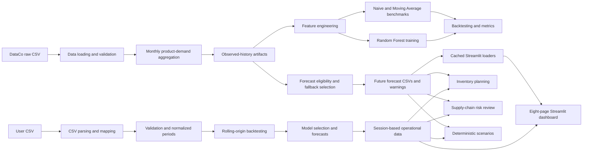

# Supply Chain Risk & Demand Forecasting

An end-to-end supply chain analytics and demand forecasting project built with Python, Streamlit, Pandas, scikit-learn, and Plotly. The project combines historical DataCo-style demand analysis, a user-upload forecasting workflow, model evaluation, inventory decision support, demand-risk indicators, scenario analysis, SQL reporting, and a Power BI deliverable.

The application is a decision-support and analytical interface, not a production inventory or purchasing system. Forecasts, risk indicators, inventory estimates, and scenarios must be interpreted against the source data, warning messages, and documented assumptions.

## Project goals

- Prepare and audit historical product-demand data.
- Preserve missing product-month observations instead of treating them as zero demand.
- Compare Naive, Moving Average, and Random Forest forecasting approaches.
- Generate forecast coverage and data-quality warnings.
- Let users upload and prepare their own demand CSV data.
- Present forecasts, model performance, inventory estimates, demand-risk indicators, and scenario comparisons in Streamlit.
- Preserve reproducible SQL and Power BI components alongside the Python application.

## Key features

- Interactive, theme-aware Streamlit dashboard.
- DataCo demonstration data and session-based user-uploaded datasets.
- Product-level and portfolio-level demand views.
- Forecast eligibility, confidence, staleness, and missing-history diagnostics.
- Rolling-origin and historical model evaluation.
- Feature-importance and per-product error views.
- Explicit inventory assumptions supplied by the user.
- Explainable demand-risk indicators with no arbitrary composite risk score.
- Deterministic forecast scenario multipliers.
- Downloadable forecast and evaluation outputs in the upload workflow.

## Dashboard pages

The application registers eight pages in the following sidebar groups.

| Group | Page | Purpose |
|---|---|---|
| OVERVIEW | [Executive Overview](dashboard/pages/01_executive_overview.py) | Portfolio demand, forecast commitments, data-quality KPIs, and provenance. |
| DEMAND INTELLIGENCE | [Demand Analytics](dashboard/pages/02_demand_analytics.py) | Historical demand trends, SKU filtering, seasonality, volume concentration, and demand-regime transitions. |
| DEMAND INTELLIGENCE | [Demand Forecasting](dashboard/pages/03_demand_forecasting.py) | Selected-SKU forecasts, forecast confidence, schedule details, and data-quality warnings. |
| DEMAND INTELLIGENCE | [Model Performance](dashboard/pages/04_model_performance.py) | Benchmark metrics, feature importance, per-product errors, and later-period rolling evaluation. |
| DEMAND INTELLIGENCE | [Inventory Management](dashboard/pages/05_inventory_management.py) | Stock depletion, safety stock, reorder-point, and EOQ estimates using explicit user inputs. |
| OPERATIONS | [Supply Chain Risk](dashboard/pages/06_supply_chain_risk.py) | Explainable stale-history, short-history, fallback, gap, and backtest indicators. |
| OPERATIONS | [Scenario Simulator](dashboard/pages/07_scenario_simulator.py) | Deterministic portfolio or product-level forecast multipliers and deltas. |
| OPERATIONS | [User Demand Forecasting](dashboard/pages/08_user_demand_forecasting.py) | CSV upload, column mapping, validation, preparation, model comparison, and forecast generation. |

The first registered page, Executive Overview, is the default route at `/`.

## Requirements

The project declares:

- Python `>=3.11`
- [Pandas](https://pandas.pydata.org/docs/)
- [NumPy](https://numpy.org/doc/)
- [Matplotlib](https://matplotlib.org/stable/)
- [scikit-learn](https://scikit-learn.org/stable/)
- [pytest](https://docs.pytest.org/)
- [Streamlit](https://docs.streamlit.io/) `>=1.51.0`
- [Plotly](https://plotly.com/python/) `>=5.22.0`

The exact declarations are maintained in [requirements.txt](requirements.txt) and [pyproject.toml](pyproject.toml). The project version is `0.1.0` as declared in [pyproject.toml](pyproject.toml); the README does not infer any additional published version.

## Installation

### Windows

Open PowerShell in the repository directory and run:

```powershell
python -m venv .venv
.\.venv\Scripts\Activate.ps1
python -m pip install --upgrade pip
python -m pip install -r requirements.txt
```

If PowerShell blocks virtual-environment activation, either open PowerShell with appropriate policy permissions or run the app with the virtual environment explicitly:

```powershell
.venv\Scripts\python.exe -m pip install -r requirements.txt
.venv\Scripts\python.exe -m streamlit run dashboard/app.py
```

### macOS and Linux

```bash
python3 -m venv .venv
source .venv/bin/activate
python -m pip install --upgrade pip
python -m pip install -r requirements.txt
```

## Run and access the dashboard

From the repository root, with the environment active:

```bash
python -m streamlit run dashboard/app.py
```

The local application address is normally:

```text
http://localhost:8501
```

Streamlit also prints a network address, for example `http://<computer-ip>:8501`. Open that address from another device only when the host device and the remote device can reach each other over the network and when local firewall or network rules permit the connection.

### Local versus hosted access

- **Local:** Run Streamlit on your computer and open `localhost:8501`.
- **Network:** Run on a network-connected computer and use the network URL printed by Streamlit.
- **Hosted:** A hosted URL is not established by this repository. To deploy on Streamlit Community Cloud, select this repository and branch and set `dashboard/app.py` as the app entry point. Cloud installs `requirements.txt` and uses the version-controlled DataCo dashboard CSV artifacts; it does not run the pipeline.

The original DataCo source CSV and unrelated generated outputs are intentionally not committed. To refresh the dashboard's DataCo artifacts, supply `data/raw/integrated_supply_chain_until_aug2017.csv`, run `python run_pipeline.py` locally, review the regenerated artifacts, and commit only the dashboard files allowed by `.gitignore`. User-uploaded CSVs remain an independent workflow and are not written over DataCo files.

To stop a Streamlit process started interactively, use `Ctrl+C` in the terminal that started it.

## Common setup problems

- **The `streamlit` command is unavailable:** Use `python -m streamlit run dashboard/app.py` or activate the virtual environment first.
- **Imports cannot be resolved:** Run commands from the repository root so the project package paths are available.
- **Dashboard data files are missing:** Restore the version-controlled dashboard artifacts. To regenerate them locally, first supply `data/raw/integrated_supply_chain_until_aug2017.csv`, then run `python run_pipeline.py`. Streamlit Cloud does not run the pipeline on page loads or reruns.
- **User-upload pages have no operational data:** Upload and prepare a CSV on User Demand Forecasting, run model comparison, generate forecasts, and then select the User-uploaded dataset on an operations page.
- **Port 8501 is in use:** Stop the existing Streamlit process or start with `python -m streamlit run dashboard/app.py --server.port 8502`.
- **Missing forecast rows:** Review the forecast warnings and eligibility information rather than assuming that a product is eligible for forecasting.

## Project structure

```text
Supply-Chain-Risk-Demand-Forecasting/
├── dashboard/
│   ├── app.py                      # Streamlit entry point and navigation
│   ├── operational_data.py         # DataCo/user-upload operational dataset adapter
│   ├── user_demand_forecasting.py  # Upload, preparation, backtesting, and forecast integration
│   ├── components/
│   │   ├── app_header.py           # Native Streamlit header branding
│   │   ├── charts.py               # Shared Plotly chart builders
│   │   ├── kpi_cards.py            # KPI and page-header components
│   │   └── sidebar.py              # Shared sidebar selectors
│   ├── data/
│   │   └── loader.py               # Cached dashboard CSV loaders
│   ├── pages/
│   │   ├── 01_executive_overview.py
│   │   ├── 02_demand_analytics.py
│   │   ├── 03_demand_forecasting.py
│   │   ├── 04_model_performance.py
│   │   ├── 05_inventory_management.py
│   │   ├── 06_supply_chain_risk.py
│   │   ├── 07_scenario_simulator.py
│   │   └── 08_user_demand_forecasting.py
│   └── styles/                     # Theme palette and Plotly layout
├── data/
│   ├── raw/                        # Configured source and raw assets
│   ├── processed/                  # Rebuilt monthly demand artifacts
│   └── quality_review/             # Missingness and lifecycle review artifacts
├── docs/                           # Technical notes and historical results
├── outputs/
│   ├── forecasts/                  # Forecast and evaluation outputs
│   ├── inventory/                  # Configured inventory output location
│   ├── risk/                       # Configured risk output location
│   ├── scenarios/                  # Configured scenario output location
│   └── handoff/
├── sql/
│   ├── queries.sql
│   └── reports/                    # Data-quality and SQL investigation queries
├── src/
│   ├── analysis/
│   │   ├── build_monthly_demand.py
│   │   └── analyze_demand_shift.py
│   ├── data/
│   │   ├── loaders.py
│   │   ├── validators.py
│   │   └── user_demand.py
│   ├── database/                   # Local database inspection utilities
│   ├── forecasting/
│   │   ├── baseline.py
│   │   ├── models.py
│   │   ├── run_random_forest_experiment.py
│   │   ├── generate_future_forecasts.py
│   │   ├── evaluation.py
│   │   ├── forecasting_improvement_experiment_v2.py
│   │   └── user_demand_backtesting.py
│   ├── inventory/
│   │   └── inventory_analysis.py
│   ├── preprocessing/
│   │   ├── cleaning.py
│   │   ├── feature_engineering.py
│   │   └── user_demand_preparation.py
│   ├── risk/
│   │   └── risk_score.py
│   ├── scenarios/
│   │   └── simulation.py
│   └── visualization/              # Pipeline visualization helpers
├── tests/                          # pytest coverage for modules and dashboard workflows
├── Supply_Chain_PowerBI/           # Power BI project and prepared data
├── config.py                       # Configured project and data paths
├── run_pipeline.py                 # Four-stage historical pipeline runner
├── main.py                         # CSV inspection utility
├── requirements.txt
├── pyproject.toml
└── README.md
```

## System architecture



## Data loading and preprocessing

### Historical DataCo workflow

The configured historical source is [config.py](config.py):

```text
data/raw/integrated_supply_chain_until_aug2017.csv
```

The configured August 2017 source is verified to contain:

- 166,773 transaction rows.
- 34 columns.
- 87 distinct product IDs.
- Order dates from January 1, 2015 through August 31, 2017.

The repository also preserves [integrated_supply_chain.csv](data/raw/integrated_supply_chain.csv) as the full original source. It contains 180,519 rows and 118 distinct products and includes additional records from September 2017 through January 2018.

The two source files are not interchangeable. `config.py` deliberately selects the August 2017 file for the configured pipeline. The full source is preserved for investigation and historical artifact context, but it is not the active configuration.

The historical `run_random_forest_experiment.py` workflow uses an explicitly defined training period ending in October 2016 and a holdout period from November 2016 through January 2017. Its holdout is an in-code historical evaluation window; later data in the full source is not silently added as additional holdout data. Separate later-period experiment scripts exist, but they use their own source files and eligibility rules and are not evidence that their results belong to the implemented future forecast generator.

[src/analysis/build_monthly_demand.py](src/analysis/build_monthly_demand.py) validates the raw order data, parses order dates, converts quantity values, and groups valid transaction items by `month` and `product_id`.

Monthly aggregation adds:

- `demand_units`: sum of quantity.
- `transaction_rows`: number of transaction rows.
- `unique_orders`: number of unique order identifiers when `order_id` is available.

The builder creates observed product-month rows only. It does not add a demand value for every product-month in a global grid. The quality review creates a separate panel to classify missing combinations.

Missing periods are classified as:

- Before the first observed product month.
- After the last observed product month.
- Missing internally between a product's first and last observed month.

These conditions remain unknown; they are not silently treated as confirmed zero demand. Confirmed-zero logic belongs only to the user-demand workflow when the source coverage and zero-demand options explicitly establish it.

The rebuild writes monthly and quality artifacts under [data/processed](data/processed) and [data/quality_review](data/quality_review). [dashboard/data/loader.py](dashboard/data/loader.py) provides cached dashboard functions that read those generated CSV files by resolved project-relative paths. It uses file modification time and size as part of the cache key, so regenerated files are reloaded without reconstructing the monthly-demand or forecast logic inside page scripts.

### User-upload workflow

[dashboard/user_demand_forecasting.py](dashboard/user_demand_forecasting.py) and [src/preprocessing/user_demand_preparation.py](src/preprocessing/user_demand_preparation.py) provide the upload workflow:

1. Accept a UTF-8 CSV with a `.csv` extension.
2. Inspect headers and suggest date, demand, product, and category columns.
3. Parse dates and demand values.
4. Normalize periods to daily, weekly, or monthly frequency.
5. Aggregate transaction rows if requested.
6. Preserve unknown periods where observations are missing.
7. Produce a data-quality report and per-series diagnostics.
8. Run eligible rolling-origin backtests.
9. Generate forecasts and expose them as session-only operational data.

An uploaded source is not written over the DataCo CSV or forecast files. Operational pages can switch between DataCo and the verified user-upload bundle through existing session state.

## Forecasting methodology

### Feature engineering

[src/preprocessing/feature_engineering.py](src/preprocessing/feature_engineering.py) creates leakage-safe features:

- Lags: 1, 2, 3, 6, and 12 months.
- Prior three-period rolling mean.
- Prior six-period rolling mean.
- Month number.
- Quarter.

The target is not included in its own lag or rolling feature. Rolling features shift first and therefore use earlier observations only.

### Naive forecasting

[src/forecasting/baseline.py](src/forecasting/baseline.py) implements the Naive baseline as the previous observation.

### Moving Average forecasting

[src/forecasting/baseline.py](src/forecasting/baseline.py) implements a three-period rolling average for the baseline workflow. The future forecast generator uses the mean of the latest available actual observations, limited to three records.

### Random Forest forecasting

[src/forecasting/models.py](src/forecasting/models.py) uses `RandomForestRegressor` with:

- 200 estimators.
- Maximum depth of 5.
- Random state of 42.
- Parallel fitting through `n_jobs=-1`.

### Recursive future forecasts

[src/forecasting/generate_future_forecasts.py](src/forecasting/generate_future_forecasts.py) is the tiered forecast generator:

1. Split observed history into contiguous monthly runs.
2. Use recursive Random Forest forecasting when the latest contiguous run has more than 12 observations.
3. Use the latest up-to-three-observation mean as a Moving Average fallback when at least two observed records are available.
4. Use the latest observed value as a Naive fallback for a single observed record.
5. Generate three forecast periods.
6. Append each Random Forest prediction to the forecast history for the next recursive step.
7. Clip negative Random Forest predictions to zero.

Missing months break a contiguous run. They are not inserted into the forecast training history as zeros.

### Forecast eligibility and confidence

The implemented tiering is:

| Available history | Method | Confidence |
|---|---|---|
| Latest contiguous run greater than 12 observed months | Recursive Random Forest | HIGH |
| At least two observed records, below the RF tier | Moving Average baseline | MEDIUM |
| One observed record | Naive baseline | LOW |
| No observed history | No forecast; product is identified as skipped | Unavailable |

Confidence is a data-quality heuristic, not a calibrated probability or guarantee of forecast accuracy.

### Backtesting and metrics

[src/forecasting/evaluation.py](src/forecasting/evaluation.py) provides the metric calculations. The historical [run_random_forest_experiment](src/forecasting/run_random_forest_experiment.py) workflow requires complete, consecutive monthly coverage across the training and test windows.

- **MAE:** Mean Absolute Error, in demand units.
- **RMSE:** Root Mean Squared Error, in demand units.
- **WAPE:** Weighted Absolute Percentage Error. It is unavailable when the denominator is zero or not sufficiently comparable.

The complete-history rolling and historical evaluation utilities remain separate from the future tiered forecast generator. Experiment outputs should not be presented as production-validated performance.

## Historical benchmark results

The existing [docs/forecasting_results.md](docs/forecasting_results.md) preserves a historical benchmark for a previous source artifact:

- Training through October 2016.
- Test period: November 2016 through January 2017.
- 54 complete-history products.
- 162 product-month test observations.

Pooled historical results:

| Model | MAE | RMSE | WAPE |
|---|---:|---:|---:|
| Naive | 23.43 | 46.15 | 10.89% |
| Moving Average | 17.29 | 31.74 | 8.03% |
| Random Forest | 15.55 | 27.17 | 7.22% |

These metrics describe a historical experiment from an earlier generated source and must not be presented as validation of the currently configured source or live forecasts. The documented source-caveat report explains that the pipeline and dependent outputs may require regeneration after the source changed.

Additional benchmark context is maintained in [docs/forecast_confidence_review.md](docs/forecast_confidence_review.md).

### Later experiments

The repository also contains separate later-period and rolling-origin experiment code:

- [forecasting_improvement_experiment.py](src/forecasting/forecasting_improvement_experiment.py) and [forecasting_improvement_experiment_v2.py](src/forecasting/forecasting_improvement_experiment_v2.py) rescore stable historical origins within a predeclared regime.
- [compare_later_period_models.py](src/forecasting/compare_later_period_models.py) compares model configurations over a later May–October 2017 test window.
- [evaluate_later_period.py](src/forecasting/evaluate_later_period.py) provides a one-step-ahead later-period evaluation starting after April 2017.

These experiments are not the currently implemented future forecast generator. Their cohorts, source files, horizons, and eligibility rules differ, so their results should not be combined into one portfolio metric or described as production performance. The existing confidence review records a separate 12-origin V2 comparison for the stable period: Naive 22.07 MAE / 10.39% pooled WAPE, Moving Average 18.65 / 8.78%, and Random Forest 18.03 / 8.48%. It explicitly treats those results as comparative historical evidence, not calibrated confidence or future accuracy.

## Inventory planning

[src/inventory/inventory_analysis.py](src/inventory/inventory_analysis.py) provides exploratory calculations for the selected operational dataset:

- Observed and forecast average demand per period.
- Lead-time demand distributed across the selected forecast period.
- Safety stock using user-entered lead-time variability and a normal quantile.
- Reorder point as lead-time demand plus supported safety stock.
- EOQ using user-entered ordering and annual holding costs.
- Depletion status and projected stockout dates using uniform demand within each forecast period.

Safety stock requires at least 12 contiguous observed periods and a supplied lead-time standard deviation. EOQ requires ordering and holding cost inputs. Current stock and supplier lead time are not inferred from DataCo source fields.

These outputs are estimates based on explicit assumptions. They are not purchasing or replenishment recommendations until validated with real operational balances and supply terms.

## Supply-chain risk indicators

[src/risk/risk_score.py](src/risk/risk_score.py) creates explainable, independent indicators:

- Stale history.
- Short history.
- Baseline fallback.
- Internal missing periods.
- Intermittent or irregular demand patterns for uploaded data.
- Trend-screening evidence for uploaded data.
- Comparable backtest evidence when sufficient origins exist.

The DataCo risk view does not claim to measure supplier reliability, logistics bottlenecks, geopolitical exposure, single-source dependency, or actual disruptions. The implementation does not calculate an arbitrary composite risk score.

For uploaded datasets, the risk register reads the normalized demand diagnostics and the existing rolling-origin comparison. Unknown periods remain unknown and are not treated as confirmed zeros.

## Scenario simulation

[src/scenarios/simulation.py](src/scenarios/simulation.py) applies deterministic multipliers to saved forecast values:

- Optimistic: default `1.10`.
- Pessimistic: default `0.90`.
- User-defined: default `1.00`.

The module produces unit and percentage deltas for each forecast period. Portfolio scenarios aggregate product rows by period before recalculating totals. Percentage deltas are unavailable when the baseline period is zero.

The simulator does not use residual uncertainty as a probability distribution. It does not perform Monte Carlo simulation, estimate demand elasticity, or model supplier shocks.

## Run the historical pipeline

Launching Streamlit and running the historical pipeline are separate operations:

- `python -m streamlit run dashboard/app.py` starts the interactive dashboard only. It does not rebuild monthly demand or regenerate forecast CSVs.
- `python run_pipeline.py` runs the backend historical pipeline only. It requires the original DataCo source at `data/raw/integrated_supply_chain_until_aug2017.csv`, rebuilds monthly-demand artifacts, performs the historical evaluation workflow, generates future forecast outputs, and builds demonstration visualizations. It does not start a web server. The raw source is not committed; the small dashboard runtime artifacts are version-controlled so the hosted app does not need to rebuild them.

The complete [run_pipeline.py](run_pipeline.py) runner executes four stages:

1. Build monthly demand.
2. Run the recursive Random Forest and baseline evaluation workflow.
3. Generate future tiered forecasts and warnings.
4. Build demonstration visualizations.

Run from the repository root:

```bash
python run_pipeline.py
```

The runner stops at the first failed stage and leaves its stage status in the terminal output.

Individual modules can also be called where appropriate:

```bash
python -m src.analysis.build_monthly_demand
python -m src.forecasting.run_random_forest_experiment
python -m src.forecasting.generate_future_forecasts
python -m src.visualization.forecast_demo
```

Running the pipeline regenerates forecast and data-quality outputs. Review the source configuration and generated timestamps before interpreting results.

The `main.py` entry point is a CSV inspection utility, not the Streamlit dashboard. It requires a file argument:

```bash
python main.py --file data/raw/integrated_supply_chain_until_aug2017.csv
```

## Testing

The test suite is located under [tests](tests) and covers data loading, validation, preprocessing, feature engineering, forecasting, backtesting, pipeline orchestration, inventory analysis, risk scoring, scenario simulation, and dashboard workflows.

Run the complete suite from the repository root:

```bash
python -m pytest -q
```

Run a focused test file while developing a specific area:

```bash
python -m pytest tests/test_scenario_simulation.py -q
python -m pytest tests/test_user_demand_forecasting_page.py -q
```

The repository does not claim a current complete-suite pass count unless that suite has been run in the current environment.

## SQL analysis

[sql/queries.sql](sql/queries.sql) and [sql/reports](sql/reports) contain SQL analysis for:

- Catalogue coverage by month.
- Monthly sales trends.
- Product-level demand.
- Order structure.
- Sales and product calculations.
- Product IDs by month.
- Late delivery risk.
- Delivery performance.
- Data-quality checks.

Findings and caveats are documented in [docs/sql_data_quality_investigation.md](docs/sql_data_quality_investigation.md).

The SQL assets are local analytical resources. The repository documentation should be used to verify which database or source snapshot supplied a particular report.

## Power BI

The repository includes:

- [Supply_Chain_PowerBI/Documentation/dashboard.pbix](Supply_Chain_PowerBI/Documentation/dashboard.pbix)
- [Supply_Chain_PowerBI/Data](Supply_Chain_PowerBI/Data)

The Power BI deliverable complements the Python and Streamlit workflows. Prepared CSV files are separate analytical artifacts and should not be assumed to represent a live or automatically refreshing data source.

## Technical documentation

Keep these existing project documents for detailed context:

- [docs/forecasting_results.md](docs/forecasting_results.md) — historical benchmark and forecast handoff.
- [docs/forecast_confidence_review.md](docs/forecast_confidence_review.md) — confidence, fallback, and evaluation review.
- [docs/dataco_operations_modules.md](docs/dataco_operations_modules.md) — inventory, risk, and scenario behavior.
- [docs/forecasting_data_contract.md](docs/forecasting_data_contract.md) — forecasting data contracts.
- [docs/sql_data_quality_investigation.md](docs/sql_data_quality_investigation.md) — SQL quality investigation.
- [docs/PROJECT_CLEANUP_AUDIT.md](docs/PROJECT_CLEANUP_AUDIT.md) — project cleanup and consistency review.

## Technology stack

| Technology | Use |
|---|---|
| Python 3.11+ | Core application and analytics |
| Pandas | Tabular data loading and transformation |
| NumPy | Numerical calculations |
| scikit-learn | Random Forest forecasting |
| Streamlit | Multi-page dashboard and native sidebar navigation |
| Plotly | Interactive charts |
| Matplotlib | Static pipeline visualizations |
| pytest | Automated tests |
| SQL / SQLite-related assets | Data investigation and reporting |
| Power BI | Complementary business-intelligence deliverable |

## Limitations and responsible interpretation

- The configured DataCo source ends in August 2017, so forecast periods and historical cutoffs are historical demonstrations rather than live predictions.
- Existing generated outputs may be stale relative to source files. Regenerate and validate them before interpreting current results.
- Missing product-month observations are not inferred to be zero demand.
- Baseline and fallback forecasts are not equivalent to validated Random Forest predictions.
- Backtest performance does not guarantee future accuracy.
- Confidence labels describe history and data quality, not calibrated forecast probability.
- Inventory estimates depend on user-supplied stock, lead-time, variability, ordering, and holding assumptions.
- Supply-chain risk indicators do not establish supplier reliability, geopolitical exposure, logistics capacity, or actual disruption.
- Scenario outputs are deterministic multipliers, not uncertainty distributions or causal estimates.
- User-uploaded forecasts depend on the uploaded coverage, frequency, and eligibility of the selected series.

## Developer guidance

- Start with [dashboard/app.py](dashboard/app.py) for navigation and native application configuration.
- Add or change a dashboard page under [dashboard/pages](dashboard/pages), then register it in `dashboard/app.py`.
- Reuse [dashboard/components/charts.py](dashboard/components/charts.py), [dashboard/components/kpi_cards.py](dashboard/components/kpi_cards.py), and [dashboard/styles](dashboard/styles) for consistent UI behavior.
- Keep new data loading on cached [dashboard/data/loader.py](dashboard/data/loader.py) functions where appropriate.
- Keep business calculations in `src/`, and keep page scripts focused on loading, controls, and presentation.
- Validate missing periods explicitly; do not fill absent product-month rows with demand zeros.
- Keep forecast confidence, skipped products, warnings, and unavailable metrics visible.
- Add focused tests under [tests](tests) when changing data contracts or page behavior.
- Run the relevant tests and `git diff --check` before submitting changes.

## Project objective

The project demonstrates a transparent supply chain analytics workflow that connects source validation, monthly demand preparation, baseline and machine-learning forecasting, evaluation, user-upload forecasting, inventory estimates, demand-risk indicators, scenarios, SQL, Power BI, and an interactive web dashboard.
